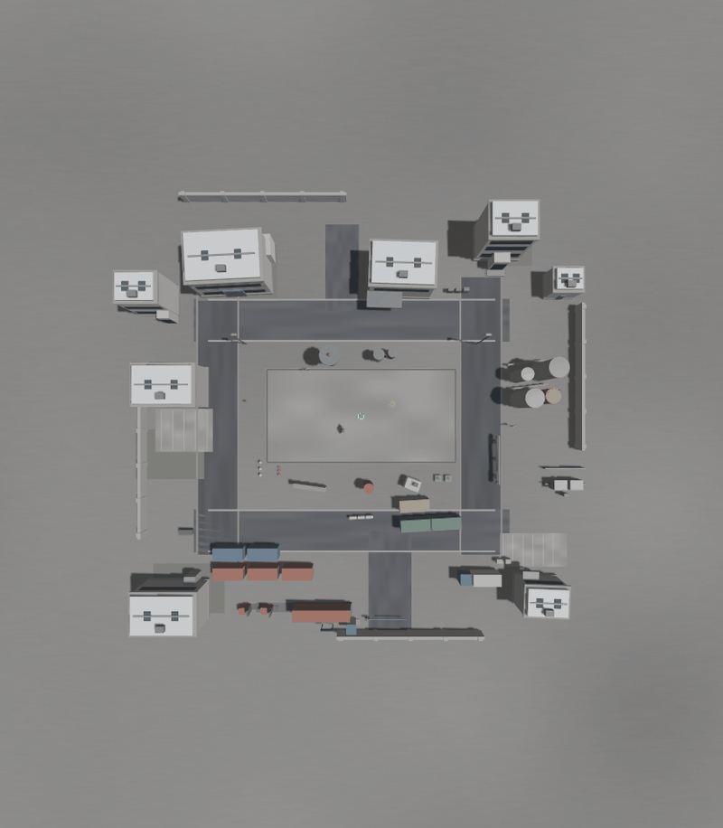
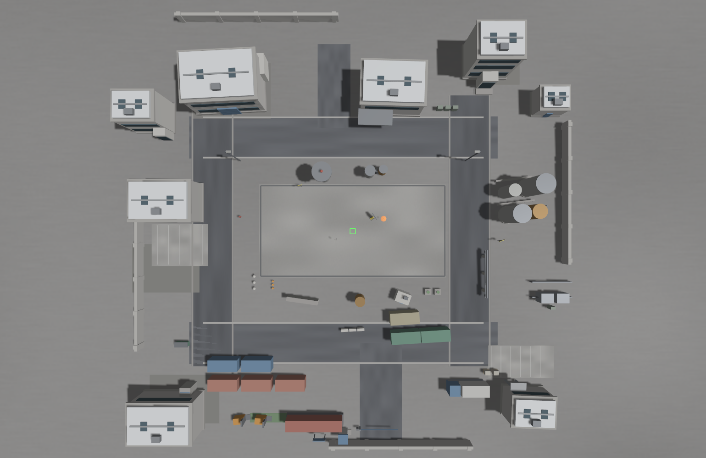
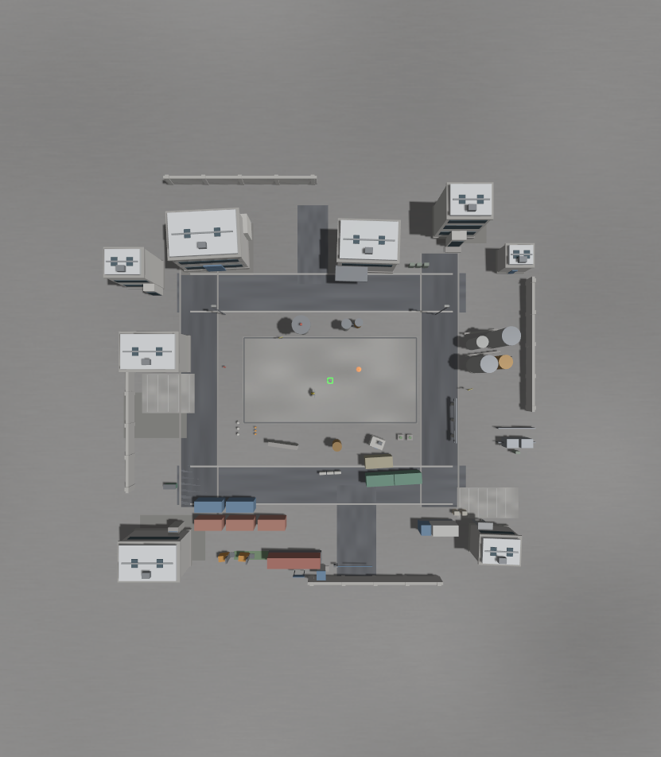
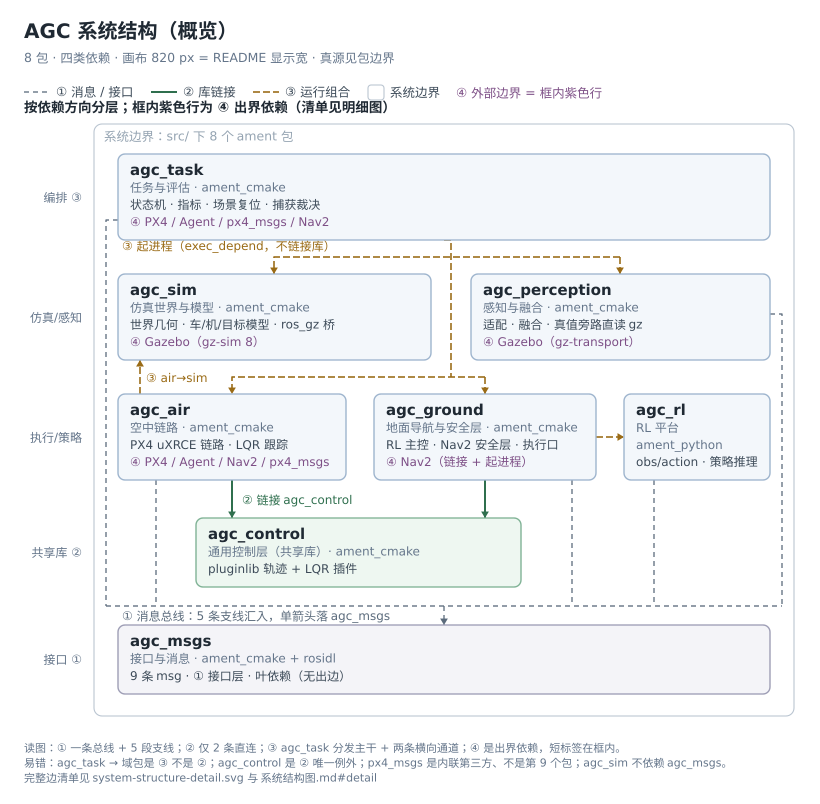

# AGC · 空地协同反无人机仿真

> **一句话**：同一世界、同一时钟下，**无人机**与**地面车**协同完成"发现 → 跟踪 → 抵近"任务——
> 空中持续跟踪目标并保持安全间距，地面车自主规划接近，抵达跟踪距离后持续驻留判定成功。

<p align="center">
  
</p>

<p align="center">
  
</p>

纯仿真项目：**ROS 2 Jazzy + Gazebo Harmonic (gz-sim 8) + PX4 SITL**，在 Ubuntu 24.04 / WSL2 上开发。
不接实机（见 [已知边界](#已知边界当前能力范围)），全部动力学由 Gazebo 物理引擎计算。

## 这是什么

**问题**：低空小型无人机入侵需要"看得见、追得上、够得着"的闭环。单一平台做不到——
空中平台看得远但停不住，地面平台能停但视野低。

**方案**：把两者放进**同一个仿真世界、同一个时钟**，共享一套任务定义：

| 角色 | 职责 | 包 |
|---|---|---|
| 空中平台（PX4 四旋翼） | 常开跟踪目标、保持安全间距、自身避障 | `agc_air` |
| 地面平台（差速 UGV） | 自主规划接近、Nav2 安全层、RL 主控链路 | `agc_ground` |
| 感知 | 真值派生 / 视觉两条**互斥**路径 | `agc_perception` |
| 任务 | 确定性状态机、终态裁决、指标落盘 | `agc_task` |

**当前状态**：主场景 `s04_static_static_obs_track` 在 `yard` 地图上**可复现跑通**，
终态 `TRACKING_SUCCESS`（"抵近并持续跟踪"，阶段 A）——**这不是"拦截完成"**。
阶段 B 的拦截（`INTERCEPT_CONFIRMED`）另有终态与判据，见
[终态语义](docs/ROS2迁移交接文档.md#terminal-semantics)。

## 快速开始

```bash
./run_demo.sh doctor    # ① 环境自检（14 项，≤30 s，不启动任何仿真）
./run_demo.sh           # ② 跑默认演示（GUI + yard 地图 + 主场景 s04）
./run_demo.sh stop      # ③ 停止（另一个终端也可；幂等）
```

前提（三条，缺一不可）：

1. **ROS 2 Jazzy** 已安装（`/opt/ros/jazzy/setup.bash` 存在）；
2. **工作区已构建**：`colcon build --symlink-install`（首次约 5–6 分钟，9 个包）；
3. **`toolchain/` 已备**：PX4 SITL + uXRCE-DDS Agent。该目录**不纳入版本控制**（`.gitignore` 只放行
   `toolchain/README.md`），新 clone 里是空的——按 [toolchain/README](toolchain/README.md) 的
   pin 清单与构建配方自行构建。

> ⚠ **本仓脚本假定项目位于 `/home/chen/AGC`**：`run_demo.sh` 与 `scripts/demo/` 使用该绝对路径
> 定位工作区与产物目录。**在别的目录 clone 后直接跑会操作原仓库路径**（`doctor` 也可能误报通过）。
> 当前版本请**在 `/home/chen/AGC` 下使用**；路径可移植性见「已知边界」第 7 条。

> **默认演示要等 45–60 秒才开始动**：`backend:=full` 有 PX4 己方 25 s / 入侵者 35 s 错峰
> （[ADR-0094](docs/adr/0094-uxrce-participant-warmup-and-px4-stagger.md)）。脚本分段打印进度，
> 不是卡死。快速看效果用 `./run_demo.sh --backend lightweight`（几秒起，无空中链路）。

## 演示看到什么

终端有 **2 Hz 状态面板**；Gazebo 是**俯视场景图**，目标带 1.2 m 半透明橙色自发光球，一眼可辨。

| 终端面板 | 观众该理解什么 |
|---|---|
| `系统待命` | 还没开始 |
| `无人机搜索中` | 在找目标 |
| `已发现目标` | 看见了 |
| `地面车前往目标` | 正在靠近 |
| `抵近并持续跟踪成功` | **完成**（阶段 A 跟踪，不是击落） |
| `未能在时限内达成` | 失败，附原因码 |
| `系统故障（非任务失败）` | 环境问题，不算任务失败 |

一次成功演示的真实时间线（`experiments/demo/` 内可查）：

```text
[00:31.0] 整链就绪（start_service / gt / cmd_vel / odom 全新鲜）
[00:42.4] 任务启动 → AIR_SEARCH
[00:42.5] TARGET_ACQUIRED（目标观测新鲜且置信度达标）
[00:42.6] GROUND_APPROACH（地面命令回路闭环，开始接近）
[00:56.1] TRACKING_SUCCESS（目标在 3 m 内持续驻留 3 s，距离 2.5 m）
```

跑完在 `experiments/demo/<时间戳>/` 落：`timeline.txt`（事件流）、`panel.txt`（面板副本）、
`terminal_explanation.txt`（**为什么成功/失败**——阈值取本 run 实际生效参数，指标只读
`summary.json`）、`metrics/summary.json`（机器可读指标）。语义见
[P1-3 可观测与演示呈现](docs/plan/p1-3-任务可观测与演示呈现.md#p1-3-goal)。

真实运行画面（`full + yard + s04 + observe_yaw_mode=target`，**自然运行**、正俯视）：

<p align="center">
  
  
</p>
<p align="center">
  
</p>

> 三张取自同一次运行的不同时刻（t≈43 s / 55 s / 60 s），**同一尺寸**（831×952），
> 视角一致（skyband 均为 **0.00**，即正俯视）。
> **这些图是 Gazebo 3D 视图**（自然运行、正俯视 85 m）；**状态面板在终端**（2 Hz 面板 +
> `timeline.txt` / `panel.txt`），完整演示视频由用户录制——图里看不到状态，不代表系统没在报状态。
> 俯视下车辆位移只有几个像素，细节可放大查看。

## 系统结构

<p align="center">
  
</p>

8 个包按**职责域**切分（不是按进程），依赖按四类分别约束（消息 / 库链接 / 运行组合 / 外部设备）。
完整职责表与依赖规则见 [包边界](docs/conventions/包边界.md)；图的可编辑源与 Mermaid 版本见
[系统结构图](docs/conventions/系统结构图.md#top)。

```text
Gazebo（世界 + 车 + 目标 + 相机）
   ⇅  ros_gz 桥（话题 / set_pose 服务）
agc_perception（odom / gt / perception / fusion / map 适配）
   ⇅  agc_msgs（9 条消息：唯一公共接口）
agc_task（task_manager 状态机 · run_logger 指标 · 场景复位 · 捕获裁决）
   ⇅
agc_air（PX4 uXRCE-DDS · LQR 跟踪）      agc_ground（RL 主控 · Nav2 collision_monitor）
   ⇊                                       ⇊
PX4 SITL + uXRCE-DDS Agent               /agc/ground/cmd_vel（唯一执行口）
```

## 目录导航

| 路径 | 一行说明 |
|---|---|
| [`src/agc_msgs`](src/agc_msgs) | 9 条消息 / 服务定义，唯一公共接口（叶依赖） |
| [`src/agc_sim`](src/agc_sim) | Gazebo 世界、车 / UAV / 目标模型、`ros_gz` 桥、地图几何真源 |
| [`src/agc_control`](src/agc_control) | 共享控制库：pluginlib 轨迹生成器 + LQR 控制器插件 |
| [`src/agc_air`](src/agc_air) | 空中链路：PX4 uXRCE-DDS、起飞 / 悬停 / 轨迹跟踪 |
| [`src/agc_perception`](src/agc_perception) | 感知与融合：odom / gt / perception / fusion / map 适配节点 |
| [`src/agc_ground`](src/agc_ground) | 地面导航与安全层：RL 主控、Nav2 `collision_monitor` |
| [`src/agc_task`](src/agc_task) | 任务与评估：`task_manager`、`run_logger`、场景、捕获裁决 |
| [`src/agc_rl`](src/agc_rl) | RL 接口（obs / action）+ 策略加载与推理节点 |
| [`run_demo.sh`](run_demo.sh) | 一键入口：`doctor` / 演示 / `stop` / `status` / `test` / `compare` |
| [`scripts/`](scripts/README.md#top-tools) | 长期工程工具（批量实验、证据归档、索引核对） |
| [`tests/`](tests/README.md) | 验收核查（按风险项编号，多数需整链环境） |
| [`docs/plan/`](docs/plan/README.md#plan-index) | **当前方向**：项目收尾路线与各阶段出口判据 |
| [`docs/adr/`](docs/adr/README.md#adr-index) | 106 篇决策记录（编号 / 标题 / 结论索引） |
| [`docs/conventions/`](docs/conventions/包边界.md) | 工程规范：包边界、目录命名、排障速查 |

## 冒烟测试

改完代码先跑这一个命令（**离线、只读、不启仿真、5 分钟内全绿**）：

```bash
./run_demo.sh test
```

5 组：几何派生链（地图真源 → 世界 SDF）/ 9 消息 ABI 字段序 / 文档断链与锚点 /
索引一致（ADR + 脚本）/ `scripts/tests` 全部离线单测。实测 **23.4 s** 全绿。

> 它**不是**"57 个核查全绿"——那些大多要拉起完整 SITL，语义是验收不是冒烟。
> 详见 [tests/README](tests/README.md) 与 [`tests/run_smoke.py`](tests/run_smoke.py)。

## 常见问题

高频 8 条（工具链缺失 / 等待 PX4 错峰 / `ROS_DOMAIN_ID` 与发现 / 残留进程 / 图像黑屏 /
冒烟失败排查 / uXRCE participant 长尾 / "成功"到底算什么）见 **[FAQ](docs/faq.md#top)**。
面向开发者的完整判别表见 [整链排障速查](docs/conventions/整链排障速查.md#preflight)。

## 已知边界（当前能力范围）

这些是**当前版本的能力边界**，不是缺陷清单——知道边界才能正确解读结果：

1. **捕获裁决为闭式占位**：现口径"入包络即命中"只产出终态与指标，物理网发射模型尚未接入
   （[ADR-0024](docs/adr/0024-capture-adjudication-fire-control-window.md)）。阶段 B 的
   `INTERCEPT_CONFIRMED` 可演示，但**不代表**真实网捕获的物理可行性。
2. **感知为真值派生**：默认 `perception_path=truth`，目标位姿来自仿真真值经噪声 / 量程 / 视场建模，
   不是从像素识别出来的（[ADR-0020](docs/adr/0020-perception-as-truth-derived-simulation.md)）。
   结论对"感知算法本身"不成立，只对**下游决策与控制**成立。
3. **无实机验证**：全部结论来自纯仿真，接口为实机预留但未验证
   （[ADR-0009](docs/adr/0009-sim-first-with-hardware-hooks.md)）。仿真里成立的时序裕度在实机上不保证。
4. **视觉识别可插拔、默认无模型**：`perception_path=vision` 的链路（相机 → 桥 → 识别 → 降级）
   已打通，但**默认不带模型**（`vision_model.id=none`，输出空检测并显式标注降级）。
   `vision_model.id=none` 的成功 run **不得**当作视觉识别能力
   （[ADR-0103](docs/adr/0103-vision-perception-decision-path.md)）。
5. **换用相机机型对跟踪动力学的量化影响未知**：相机内参 / 安装位变化会改变观测噪声与视场，
   进而可能影响跟踪误差分布；本项目只测了 `gz_x500_mono_cam` 一种机型，**未做**跨机型的
   跟踪动力学量化对比（P1-4 第 4 项以风险登记收口，见
   [P1-4 结档裁定](docs/plan/p1-4-视觉算法接入.md#p1-4-closure)）。
6. **演示用显式 oracle 指向臂**：默认 `observe_yaw_mode=target` 让机头对准**真值方位**，
   是为隔离"指向问题"而设的**显式 oracle 臂**，不是默认 `velocity`，**也不代表**真实视觉识别。
   引用本仓结果时须同时标注该臂（[P1-2 观测指向臂](docs/plan/p1-2-一键演示入口.md#p1-2-oracle-arm)）。
7. **脚本路径不可移植（`/home/chen/AGC` 硬编码）**：`run_demo.sh` 与 `scripts/demo/` 用绝对路径
   定位工作区；在别的目录 clone 后直接跑会**操作原仓库**，且 `doctor` 可能**误报通过**（它查的是
   该绝对路径下的 `install/`）。当前版本**只保证在 `/home/chen/AGC` 下可用**；改路径需统一替换
   （已知 68 处，其中交付路径约 10 处）。

## 文档

| 入口 | 内容 |
|---|---|
| [项目完成路线](docs/plan/README.md#plan-index) | **当前方向**：P0→P2 优先级、各阶段出口判据（进度真源） |
| [契约真源](docs/ROS2迁移交接文档.md#hard-constraints) | 不可变约束、坐标系、终态语义、接口语义（**唯一**约束来源） |
| [ADR 索引](docs/adr/README.md#adr-index) | 106 篇决策的编号 / 标题 / 状态 / 结论 |
| [包边界](docs/conventions/包边界.md) | 8 包职责与四类依赖方向 |
| [FAQ](docs/faq.md#top) | 新人高频 8 条症状与处置 |
| [整链排障速查](docs/conventions/整链排障速查.md#preflight) | 故障判别顺序与处置（面向开发者） |
| [术语表](GLOSSARY.md) | 项目特有概念与边界 |
| [协作规则](.coordination/README.md#protocol) | Leader / Worker 交接与批次授权 |

> README **不复述**契约条款，只给链接（[ADR-0002](docs/adr/0002-docs-source-of-truth-layering.md)：
> 每类信息只有一个家，下游只引用）。要改约束请改契约真源，不要改这里。

## 许可与第三方资产

第三方资产（PX4、`px4_msgs`、Nav2、Gazebo、地图纹理）的来源、版本 pin、许可与哈希清单见
[ADR-0068](docs/adr/0068-third-party-asset-provenance-license-and-hash-manifest.md) 与
[第三方资产与许可](docs/conventions/第三方资产与许可.md)。
