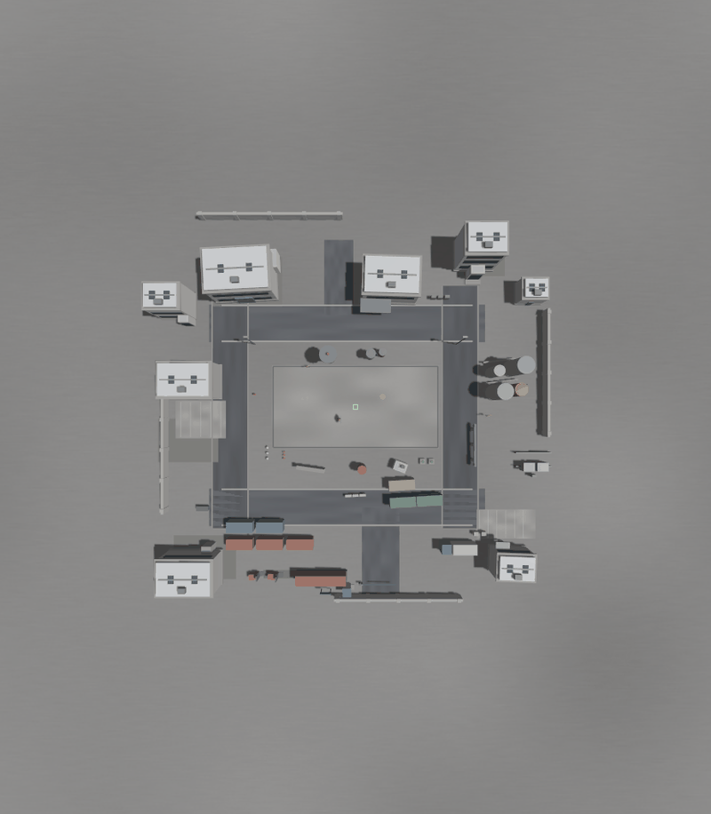
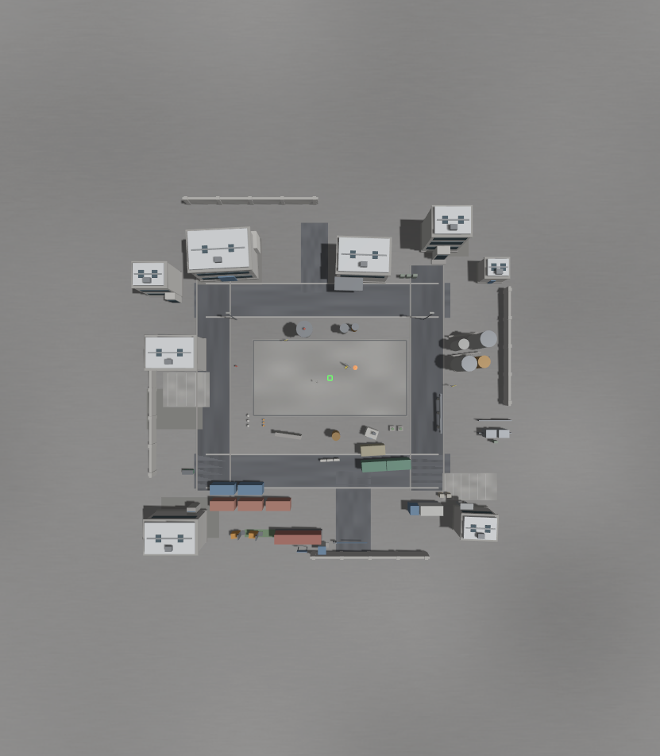
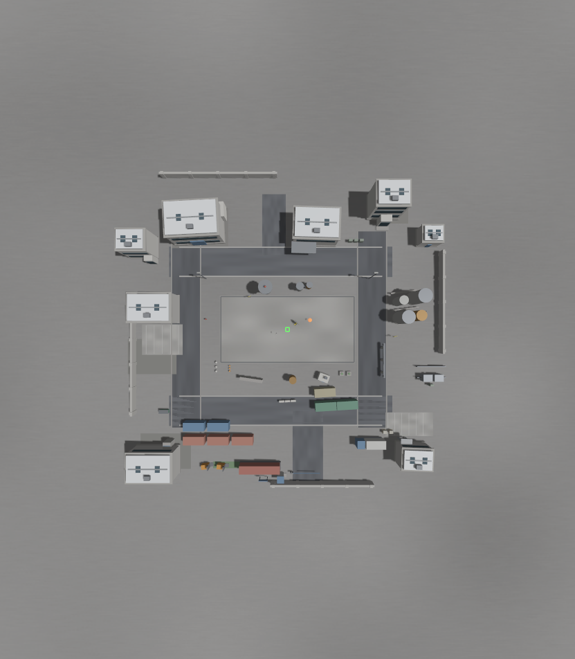

# AGC · 空地协同反无人机仿真

> **一句话**：同一世界、同一时钟下，**无人机**与**地面车**协同完成"发现 → 跟踪 → 抵近"任务——
> 空中持续跟踪目标并保持安全间距，地面车自主规划接近，抵达跟踪距离后持续驻留判定成功。

<p align="center">
  
</p>

<p align="center">
  
</p>

纯仿真项目：**ROS 2 Jazzy + Gazebo Harmonic (gz-sim 8) + PX4 SITL**，在 Ubuntu 24.04 / WSL2 上开发。
不接实机（见 [已知边界](#已知边界当前能力范围)），全部动力学由 Gazebo 物理引擎计算。

## 这是什么

**问题**：低空小型无人机入侵需要"看得见、追得上、够得着"的闭环。单一平台做不到——
空中平台看得远但停不住，地面平台能停但视野低。

**方案**：把两者放进**同一个仿真世界、同一个时钟**，共享一套任务定义：

| 角色 | 职责 | 包 |
|---|---|---|
| 空中平台（PX4 四旋翼） | 常开跟踪目标、保持安全间距、自身避障 | `agc_air` |
| 地面平台（差速 UGV） | 自主规划接近、Nav2 安全层、RL 主控链路 | `agc_ground` |
| 感知 | 真值派生（目标源：`gt_adapter`，**无几何门控、不分远近**） | `agc_perception` |
| 任务 | 确定性状态机、终态裁决、指标落盘 | `agc_task` |

**当前状态**：主场景 `s04_static_static_obs_track` 在 `yard` 地图上**可复现跑通**，
终态 `TRACKING_SUCCESS`（"抵近并持续跟踪"，阶段 A）——**这不是"拦截完成"**。
阶段 B 的拦截（`INTERCEPT_CONFIRMED`）另有终态与判据，见
[终态语义](docs/adr/0014-task-fsm-and-scenario-transaction.md#terminal-semantics)。

## 快速开始

```bash
./run_demo.sh doctor # ① 环境自检（14 项，≤30 s，不启动任何仿真）
./run_demo.sh # ② 跑默认演示（GUI + yard 地图 + 主场景 s04）
./run_demo.sh stop # ③ 停止（另一个终端也可；幂等）
```

前提（三条，缺一不可）：

1. **ROS 2 Jazzy** 已安装（`/opt/ros/jazzy/setup.bash` 存在）；
2. **工作区已构建**：`colcon build --symlink-install`（首次约 5–6 分钟，9 个包）；
3. **`toolchain/` 已备**：PX4 SITL + uXRCE-DDS Agent。该目录**不纳入版本控制**（`.gitignore` 只放行
   `toolchain/README.md`），新 clone 里是空的—— 按 [toolchain/README](toolchain/README.md) 的
   pin 清单与构建配方自行构建。

> 演示入口按自身位置定位工作区，仓库可放在任意路径；评测产物与 Git 身份也跟随当前仓库。
> 已实测克隆到 `/tmp/agc-r10-clone` 后从零构建并跑到终态。`toolchain/` 仍需按上条单独准备。

> **默认演示要等 45–60 秒才开始动**：`backend:=full` 有 PX4 己方 25 s / 入侵者 35 s 错峰
> （[ADR-0027](docs/adr/0027-uxrce-startup-reproducibility.md#top)）。脚本分段打印进度，
> 不是卡死。快速看效果用 `./run_demo.sh --backend lightweight`（几秒起，无空中链路）。

## 演示看到什么

终端有 **2 Hz 状态面板**；Gazebo 是**俯视场景图**，目标带 1.2 m 半透明橙色自发光球，一眼可辨。

| 终端面板 | 观众该理解什么 |
|---|---|
| `系统待命` | 还没开始 |
| `无人机搜索中` | 在找目标 |
| `已发现目标` | 看见了 |
| `地面车前往目标` | 正在靠近 |
| `抵近并持续跟踪成功` | **完成**（阶段 A 跟踪，不是击落） |
| `未能在时限内达成` | 失败，附原因码 |
| `系统故障（非任务失败）` | 环境问题，不算任务失败 |

一次成功演示的真实时间线（`experiments/demo/` 内可查）：

```text
[00:31.0] 整链就绪（start_service / gt / cmd_vel / odom 全新鲜）
[00:42.4] 任务启动 → AIR_SEARCH
[00:42.5] TARGET_ACQUIRED（目标观测新鲜且置信度达标）
[00:42.6] GROUND_APPROACH（地面命令回路闭环，开始接近）
[00:56.1] TRACKING_SUCCESS（目标在 3 m 内持续驻留 3 s，距离 2.5 m）
```

跑完在 `experiments/demo/<时间戳>/` 落：`timeline.txt`（事件流）、`panel.txt`（面板副本）、
`terminal_explanation.txt`（**为什么成功/失败**—— 阈值取本 run 实际生效参数，指标只读
`summary.json`）、`metrics/summary.json`（机器可读指标）。语义见
[演示可观测性与产物语义](docs/conventions/演示可观测性与产物语义.md#top)。

真实运行画面（`full + yard + s04`，**自然运行**、正俯视；观测指向臂 = `track`）：

<p align="center">
  
  
</p>
<p align="center">
  
</p>

> 三张取自同一次运行的不同时刻（t≈43 s / 55 s / 60 s），**同一尺寸**（831×952），
> 视角一致（skyband 均为 **0.00**，即正俯视）。
> **这些图是 Gazebo 3D 视图**（自然运行、正俯视 85 m）；**状态面板在终端**（2 Hz 面板 +
> `timeline.txt` / `panel.txt`），完整演示视频由用户录制—— 图里看不到状态，不代表系统没在报状态。
> 俯视下车辆位移只有几个像素，细节可放大查看。

## 系统结构

<p align="center">
  
</p>

8 个包按**职责域**切分（不是按进程），依赖按四类分别约束（消息 / 库链接 / 运行组合 / 外部设备）。
上图是**概览**（谁在哪一层、靠什么相连）；**每一类到底有哪几条边**见
[明细图](docs/conventions/assets/system-structure-detail.svg) 与
[系统结构图#detail](docs/conventions/系统结构图.md#detail)。两张图由同一张声明式表生成，
边集合由回归断言相等。完整职责表与依赖规则见 [包边界](docs/conventions/包边界.md)。

```text
Gazebo（世界 + 车 + 目标 + 相机）
   ⇅ ros_gz 桥（话题 / set_pose 服务）
agc_perception（odom / gt / map 适配）
   ⇅ agc_msgs（9 条消息：唯一公共接口）
agc_task（task_manager 状态机 · run_logger 指标 · 场景复位 · 捕获裁决）
   ⇅
agc_air（PX4 uXRCE-DDS · LQR 跟踪） agc_ground（RL 主控 · Nav2 collision_monitor）
   ⇊ ⇊
PX4 SITL + uXRCE-DDS Agent /agc/ground/cmd_vel（唯一执行口）
```

## 目录导航

| 路径 | 一行说明 |
|---|---|
| [`src/agc_msgs`](src/agc_msgs) | 9 条消息 / 服务定义，唯一公共接口（叶依赖） |
| [`src/agc_sim`](src/agc_sim) | Gazebo 世界、车 / UAV / 目标模型、`ros_gz` 桥、地图几何真源 |
| [`src/agc_control`](src/agc_control) | 共享控制库：pluginlib 轨迹生成器 + LQR 控制器插件 |
| [`src/agc_air`](src/agc_air) | 空中链路：PX4 uXRCE-DDS、起飞 / 悬停 / 轨迹跟踪 |
| [`src/agc_perception`](src/agc_perception) | 感知：odom / gt（含 bypass）/ map 适配节点 |
| [`src/agc_ground`](src/agc_ground) | 地面导航与安全层：RL 主控、Nav2 `collision_monitor` |
| [`src/agc_task`](src/agc_task) | 任务与评估：`task_manager`、`run_logger`、场景、捕获裁决 |
| [`src/agc_rl`](src/agc_rl) | RL 接口（obs / action）+ 策略加载与推理节点 |
| [`run_demo.sh`](run_demo.sh) | 一键入口：`doctor` / 演示 / `stop` / `status` / `test` / `compare` |
| [`scripts/`](scripts/README.md#top-tools) | 长期工程工具（批量实验、证据归档、索引核对） |
| [`tests/`](tests/README.md) | 验收核查（按风险项编号，多数需整链环境） |
| [`docs/plan/`](docs/plan/README.md#plan-index) | **任务计划规则**：临时工作区，写完就删；结论归宿表见该文件 |
| [`docs/adr/`](docs/adr/README.md#adr-index) | 决策记录（编号 / 标题 / 结论索引） |
| [`docs/conventions/`](docs/conventions/包边界.md) | 工程规范：包边界、目录命名、排障速查 |

## 冒烟测试

改完代码先跑这一个命令（**离线、只读、不启仿真、5 分钟内全绿**）：

```bash
./run_demo.sh test
```

9 组：入口可解析 / 几何派生链（地图配置 → 世界 SDF）/ **配置孤儿**（每个 YAML 都被引用）/
9 消息 ABI 字段序 / 文档断链与锚点 / 索引一致（ADR + 脚本）/ `scripts/tests` 全部离线单测 /
DDS 契约 / 工具链 pin。实测 **36 s** 全绿（2026-11-07，本机）。

> **它才是回归防线**：`tests/` 下另有 61 个 `check_*.py`，但其中 **90% 在新 clone 上跑不动**
> （22 个要 `experiments/` 历史证据、33 个要活仿真，只有 6 个纯静态）。
> 它们是一次性取证档案，不是"每次提交都跑"的测试套件——把两者混为一谈会得出
> "新 clone 跑不动测试 ⇒ 代码坏了"的错误结论。比例与依据见
> [tests/README](tests/README.md#categories)，由 `tests/check_doc_counts.py` 判据 f 对账。

## 常见问题

高频 8 条（工具链缺失 / 等待 PX4 错峰 / `ROS_DOMAIN_ID` 与发现 / 残留进程 / 图像黑屏 /
冒烟失败排查 / uXRCE participant 长尾 / "成功"到底算什么）见 **[FAQ](docs/faq.md#top)**。
面向开发者的完整判别表见 [整链排障速查](docs/conventions/整链排障速查.md#preflight)。

## 已知边界（当前能力范围）

这些是**当前版本的能力边界**，不是缺陷清单—— 知道边界才能正确解读结果：

1. **捕获裁决：脚本弹道预演，非真实网物理**：现行口径是「**预演弹道能命中才开火**」——
   `capture_adjudicator` 用 `net_v0_mps` / `net_angle_deg` / `net_g` 预测网到达时刻的目标位置并判可达
   （[ADR-0011](docs/adr/0011-interception-and-fire-control.md#top) (g)(h)）。
   历史「入包络即命中」的**闭式占位口径已作废**（引用旧 `CAPTURE_NET` 数据时须标注口径）。
   仍属**脚本化**弹道与命中判定，**不建模**网的柔性变形、风阻与真实气动 ⇒
   `INTERCEPT_CONFIRMED` 可演示，但**不代表**真实网捕获的物理可行性。
2. **感知为真值派生**：目标位姿来自仿真真值，**不是**从像素识别出来的
   （[ADR-0009](docs/adr/0009-perception-truth-derived-and-vision-path.md#top)）。
   结论对"感知算法本身"不成立，只对**下游决策与控制**成立。
   目标源只有一条（`/agc/target/source`）：`gt_adapter` 直取真值，**无几何门控、不分远近**
   （`air_fusion` 已于 2026-11-04 退役）。`air_perception` 节点及其 30 m 量程 / FOV 门控已于
   **2026-11-06** 随 `perception` 场景轴整体删除，故**不存在**目标可见距离限制
   （[路线分支治理 5.2](docs/conventions/路线分支治理.md#current)）。
3. **无实机验证**：全部结论来自纯仿真，接口为实机预留但未验证
   （[ADR-0001](docs/adr/0001-project-positioning-and-execution-scope.md#top)）。仿真里成立的时序裕度在实机上不保证。
4. **视觉定位路径已删除**：`perception_path=vision`（相机 → 识别 → 像素反推位置）连同
   `camera_tf` / `vision_target` / 检测器桩已于 **2026-11-04 整体退役**
   （[ADR-0009](docs/adr/0009-perception-truth-derived-and-vision-path.md#top)）。
   `/agc/targets` 的发布者恒为 `gt_adapter`（`air_fusion` 亦已于同日退役），**没有第二条路**。
   > `summary.json` 里仍带 `perception_path` / `vision_model` / `detector_backend` 三键，
   > 值恒为 `truth` / `none` / `none`—— 那是**产物 schema 不漂移**，不表示存在可选路径。
5. **换用相机机型对跟踪动力学的量化影响未知**：相机内参 / 安装位变化会改变观测噪声与视场，
   进而可能影响跟踪误差分布；本项目只测了 `gz_x500_mono_cam` 一种机型，**未做**跨机型的
   跟踪动力学量化对比。
   > **为什么不做**（判据本身不可用，不是没跑）：两臂 `err_eff` p95 为 `0.100946 m` / `0.100939 m`，
   > 相对差 −0.01%（预登记容差 20%）→ 表面 PASS，但 `standoff_follower.max_step_m=0.1` 把 p75–p95
   > 整段**饱和在 ≈0.1 m**，两臂 p95 必然相等，判据**没有判别力**；真正有区分力的是 p50（−42.41%）
   > 与 p99（−22.62%），两者均超容差。故判**完成（带已知缺口）**：不事后更换判据，若将来要下
   > "等价 / 不等价"结论须**新任务 + 新预登记**（p50+p99 / 剔除饱和样本 /速度·高度误差）。
6. **观测指向臂 = `track`（感知航迹指向，非 oracle）**：`observe_yaw_mode` 的 **launch 参数已于
   2026-11-04 清退**（对照臂结档），现在**只由 `air.yaml` 真源 + 场景覆盖**决定：
   `air.yaml` 缺省 `velocity`，`s04` 场景覆盖为 **`track`**（机头对准 `/agc/targets` 感知航迹）。
   ⇒ 主场景**不是** oracle 臂，机头指向消费的是与任务同源的感知航迹，**不读** `/agc/gt/*`。
   `target`（oracle 真值指向）与 `velocity` 两档仍保留在节点里供研究臂使用，
   但**没有** run 级 CLI 覆盖口。引用结果时须标注实际生效档（见 manifest / `summary.json`）
   （[ADR-0010](docs/adr/0010-safety-thresholds-and-failsafe.md#top) 的 oracle 臂边界）。
7. **可移植性验证有明确边界**：演示入口、评测产物与 Git 身份已实测支持克隆到任意路径；
   `toolchain/` 不入库，仍须按 `toolchain/README` 单独构建，克隆复验中借用了主仓已构建工具链，
   因此不能把该次耗时当作全新机器的完整部署耗时。研究 / 历史脚本不在本次可移植性保证范围内。

8. **机载俯视相机（opt-in，2026-11-04）**：`px4_sim_model:=gz_agc_x500_nadir` 时己方机挂一台**正下视**
   相机，桥出 `/agc/air/nadir/image_raw` + `/agc/air/nadir/camera_info`
   （[ADR-0030](docs/adr/0030-nadir-camera-capability.md#top)）。
   **仅取证/测绘，无消费者**—— 识别仍靠真值（`gt_adapter`），图像**不**接入任务链；
   默认 `gz_x500` 行为逐字不变（无相机）。实测 `yard` 14 m 下中心 GSD 5.30 cm/px、画幅 33.9×25.5 m。
   单目正俯视只能拿 **XY 足迹**，**拿不到高度 Z**（需双视差 + 专门航线）。

## 文档

| 入口 | 内容 |
|---|---|
| [任务计划规则](docs/plan/README.md#plan-index) | **临时工作区**：结论归宿表与 plan 最小结构 |
| [契约真源](docs/adr/0020-package-boundaries-and-runtime-topology.md#hard-constraints) | 不可变约束、坐标系、终态语义、接口语义（**唯一**约束来源） |
| [ADR 索引](docs/adr/README.md#adr-index) | 全部决策的编号 / 标题 / 状态 / 结论 |
| [包边界](docs/conventions/包边界.md) | 8 包职责与四类依赖方向 |
| [FAQ](docs/faq.md#top) | 新人高频 8 条症状与处置 |
| [整链排障速查](docs/conventions/整链排障速查.md#preflight) | 故障判别顺序与处置（面向开发者） |
| [术语表](GLOSSARY.md) | 项目特有概念与边界 |
| [协作规则](.coordination/README.md#protocol) | Leader / Worker 交接与批次授权 |

> README **不复述**契约条款，只给链接（[ADR-0002](docs/adr/0002-docs-source-of-truth-and-reference-discipline.md#top)：
> 每类信息只有一个家，下游只引用）。要改约束请改契约真源，不要改这里。

## 许可与第三方资产

第三方资产（PX4、`px4_msgs`、Nav2、Gazebo、地图纹理）的来源、版本 pin、许可与哈希清单见
[ADR-0005](docs/adr/0005-px4-toolchain-and-link.md#top) 与
[第三方资产与许可](docs/conventions/第三方资产与许可.md)。
