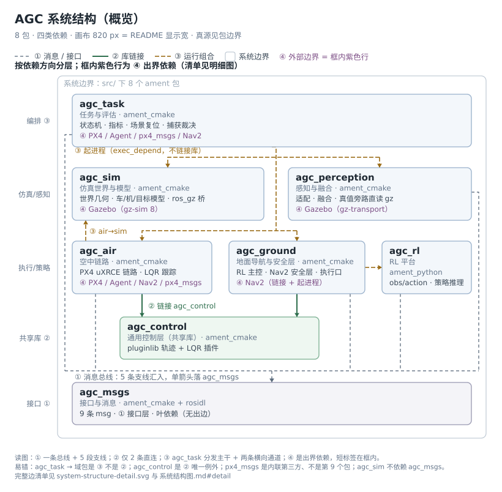
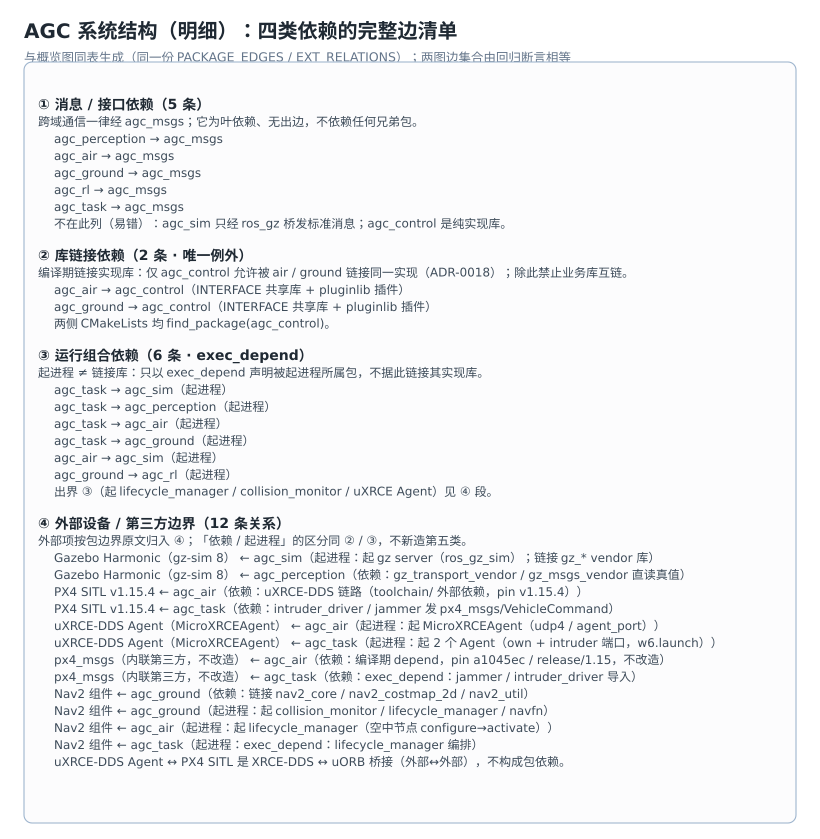
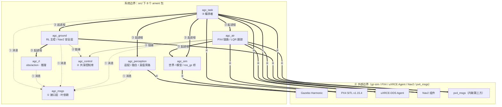
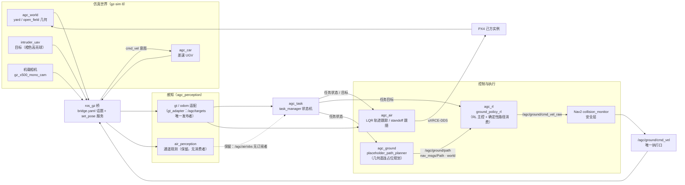

<a id="top"></a>
# 系统结构图

> 本文件是 [包边界](包边界.md#1-包清单) 的**图形式表达**，内容必须与之一致；包边界是真源，图是它的投影。
> 依赖按**四类**分别表示（消息 / 库链接 / 运行组合 / 外部设备），**不混为一条线**——
> 混为一条正是 [ADR-0020](../adr/0020-package-boundaries-and-runtime-topology.md#top) 要纠正的误读。
>
> **两张图分开读**（2026-10-31 重画）：
> [概览](#asset)回答「**谁在哪一层、靠什么相连**」，[明细](#detail)回答「**每一类到底有哪几条边**」。
> 两张图由 `scripts/demo/render_structure_svg.py` 的**同一张声明式表**生成，边集合由回归断言相等。

<a id="asset"></a>
## 资产与生成（不手绘）

<p align="center">
  
</p>

<p align="center">
  
</p>

| 项 | 位置 | 说明 |
|---|---|---|
| 概览图（入库） | [`system-structure.svg`](../plan/assets/system-structure.svg) | 画布 **820 px = README 显示宽**；正文 12 px、包名 15 px |
| 概览预览 | `system-structure.png` | 同图 @2x（1640×1608） |
| 明细图（入库） | [`system-structure-detail.svg`](../plan/assets/system-structure-detail.svg) | 四类规则 + **完整边清单**；正文 12 px |
| 明细预览 | `system-structure-detail.png` | 同图 @2x（1640×1678） |
| 生成器 | [`render_structure_svg.py`](../../scripts/demo/render_structure_svg.py) | 声明式表 → 两张 SVG / PNG；含版式、布线、标签自检 |
| 回归 | [`test_structure_diagram.py`](../../scripts/tests/test_structure_diagram.py) | 表↔真源、几何、光栅三类判据（28 项） |

```bash
python3 scripts/demo/render_structure_svg.py \
    --out        docs/plan/assets/system-structure.svg \
    --png        docs/plan/assets/system-structure.png \
    --detail     docs/plan/assets/system-structure-detail.svg \
    --detail-png docs/plan/assets/system-structure-detail.png --scale 2
```

**改图 = 改表，不是改像素**：手绘必然与真源漂移，且漂移在 diff 里看不出来。生成器把
「文字放不放得下」变成**可计算**的判据（按 DejaVu Sans 的实测字宽逐字符累加，与 Qt 实测偏差 < 6%），
所以「会不会溢出 / 压线」不需要等渲染出来才发现。

**能保证什么、不能保证什么**（避免过度承诺）：

- **能保证**：SVG `width` = README 的显示宽 = 820，即 1 SVG px = 1 CSS px 这个**前提**成立；
  文字不出框、线不穿框、标签不互压、画布四边无墨（不裁切）；同输入逐字节相同。
- **不能保证**：任何客户端在任意 DPI / 浏览器缩放 / 字体替身下的最终观感。读者若把页面缩放
  到 50%，字一样会小。**判断"是否清晰"仍需人眼看渲染结果**，脚本只排除可计算的那部分问题。

<a id="why-redraw"></a>
## 为什么重画（旧版的实际缺陷，不是审美偏好）

| 旧版问题 | 证据 | 本版做法 |
|---|---|---|
| 字太小 | 旧 SVG 1844 px、README 按 `width="820"` 显示 → 缩放 0.44；12 px 正文实际约 **5.3 CSS px** | 画布即 820 px；正文 12 px、包名 15 px |
| 线穿框压字 | 19 条**中心到中心**直线，共享库/接口层被多条线穿过 | 全正交布线：① 总线 + 侧轨、③ 分发主干 + 横向通道；`validate_routes()` 逐段检查 |
| 全连接堆叠 | ① 6 条放射线、④ 7 条穿图长线 | ① 收束为 **1 条总线 + 5 段短支线**；④ 是出界依赖，标在包框内 |
| 概览与清单同屏 | 一张图既要表达分层又要表达 25 条边，只能缩字或拉长 | **拆成两张图**：概览表达层次，[明细](#detail)列全边 |
| 与真源漂移 | 旧图画了 `agc_sim → agc_msgs`，但 `src/agc_sim/` 的 `package.xml`、`CMakeLists.txt`、源码**均无** `agc_msgs` | 已删除；回归卡住复发 |

<a id="layers"></a>
## 1. 分层总览

八包按**依赖方向**自上而下分层；下面的 Mermaid 是同一份表的 GitHub 原生渲染视图。

| 层 | 包 | 这一层靠什么串起来 |
|---|---|---|
| 编排 | `agc_task` | ③ 起进程：`exec_depend` 声明被起进程所属包，**不链接**其实现库 |
| 仿真 / 感知 | `agc_sim` · `agc_perception` | 两者都④出界到 Gazebo；`agc_sim` **没有**①出边 |
| 执行 / 策略 | `agc_air` · `agc_ground` · `agc_rl` | ② air/ground → `agc_control`；③ ground → `agc_rl` |
| 共享库 | `agc_control` | ② 被 air/ground 链接**同一实现**（ADR-0004 唯一例外） |
| 接口 | `agc_msgs` | ① 叶依赖：5 条支线汇入，**无出边** |

> **Mermaid 是简化视图**：外部项被合并进 EXT 子图，节点不写 pin / 组件名。**边与
> `EXT_RELATIONS` 逐条一致**（12 条 ④ 关系全部画出）；省略的只是文字属性，它们留在
> [明细](#detail)与 [包边界 ④ 承载者清单](包边界.md#2-依赖方向按类别分层)。
> 若两者冲突，以 `EXT_RELATIONS` 表与包边界为准。



**读图要点**（四条最容易读错的地方）：

1. **`agc_task → 其它域包`是③不是②**：它只在 launch 里**起进程**，以 `exec_depend` 声明，
   **不链接**任何域实现库（[ADR-0020](../adr/0020-package-boundaries-and-runtime-topology.md#top)）。
2. **`agc_control` 是②的唯一例外**：只有它允许被 `agc_air` / `agc_ground` 链接**同一实现**；
   其余业务库**禁止互链**（[ADR-0004](../adr/0004-ground-control-rl-primary-and-nav2-safety.md#top)）。
3. **`px4_msgs` 不是第 9 个包**：内联入库的第三方包（pin `a1045ec` / `release/1.15`），
   原样置于 `src/`、**不改造**。
4. **`agc_sim` 不依赖 `agc_msgs`**：它只经 `ros_gz` 桥发 `nav_msgs` / `sensor_msgs` /
   `rosgraph_msgs` 等**标准**消息；三处证据（`package.xml` / `CMakeLists.txt` / 源码）均无
   `agc_msgs`。旧图把它画成①依赖是漂移，已在[包边界现状解释](包边界.md#2-依赖方向按类别分层)同口径修正。

<a id="detail"></a>
## 2. 四类依赖明细

完整清单见 `docs/plan/assets/system-structure-detail.svg`；下表是同一份内容的文本版
（供检索与 diff，与图**逐条对应**）。

### ① 消息 / 接口依赖（5 条）

跨域通信**一律经** `agc_msgs`；它位于依赖图底层，为**叶依赖**、不依赖任何兄弟包。

| 源 | 关系 | 说明 |
|---|---|---|
| `agc_perception` → `agc_msgs` | `depend` | 发布观测 / 航迹 |
| `agc_air` → `agc_msgs` | `depend` | 发布空中观测 / 跟踪状态 |
| `agc_ground` → `agc_msgs` | `depend` | 消费任务目标、发布执行状态 |
| `agc_rl` → `agc_msgs` | `depend` | obs/action 经协同接口 |
| `agc_task` → `agc_msgs` | `depend` | 状态机 / logger / 裁决 |

**不在这张表里的两个包**（易错）：`agc_sim`（只经 ros_gz 桥发标准消息）、
`agc_control`（纯实现库，无消息依赖）。

### ② 库链接依赖（2 条 · 唯一例外）

| 源 | 目标 | 依据 |
|---|---|---|
| `agc_air` → `agc_control` | INTERFACE 共享库 + pluginlib 插件 | 两侧 `CMakeLists.txt` 均 `find_package(agc_control)` |
| `agc_ground` → `agc_control` | 同上 | [ADR-0004](../adr/0004-ground-control-rl-primary-and-nav2-safety.md#top) |

除此**禁止业务库互链**。`agc_control` 是 `INTERFACE` 库 + `pluginlib` 插件，导出头文件与插件描述。

### ③ 运行组合依赖（6 条 · `exec_depend`）

**起进程 ≠ 链接库**：只以 `exec_depend` 声明被起进程所属包，**不**据此链接其实现库。

| 源 | 被起进程 | 落点 |
|---|---|---|
| `agc_task` → `agc_sim` | `world_bringup.launch.py` | `w6.launch.py` |
| `agc_task` → `agc_perception` | `perception_bringup.launch.py` | `w6.launch.py` |
| `agc_task` → `agc_air` | 空中节点 + `lifecycle_manager` | `w6.launch.py` |
| `agc_task` → `agc_ground` | `ground_bringup.launch.py` | `w6.launch.py` |
| `agc_air` → `agc_sim` | `world_bringup.launch.py`（唯一世界 / 唯一时钟） | `air_bringup.launch.py` |
| `agc_ground` → `agc_rl` | `rl_inference.launch.py`（`command_source=rl`） | `ground_bringup.launch.py` |

另有**出界③**（起外部进程）：`nav2_lifecycle_manager`（air / ground / task 各自编排）、
`nav2_collision_monitor`（ground 安全层）、`MicroXRCEAgent`（air 1 个 / task 2 个）。

### ④ 外部设备 / 第三方边界（12 条关系）

外部项按包边界原文归入④；「依赖 / 起进程」的区分同②/③，**不新造第五类**。
逐条依据见 [包边界 ④ 承载者清单](包边界.md#2-依赖方向按类别分层)。

| 外部项 | 关系 |
|---|---|
| Gazebo Harmonic（gz-sim 8） | `agc_sim`（起 gz server + 链接 gz_* vendor）、`agc_perception`（链接 gz_transport / gz_msgs 直读真值位姿） |
| PX4 SITL v1.15.4 | `agc_air`（uXRCE-DDS 链路）、`agc_task`（intruder_driver / jammer 发 `px4_msgs/VehicleCommand`） |
| uXRCE-DDS Agent | `agc_air`（起 1 个）、`agc_task`（起 2 个：own + intruder 端口） |
| `px4_msgs`（内联第三方） | `agc_air`（编译期 `depend`）、`agc_task`（`exec_depend`） |
| Nav2 组件 | `agc_ground`（链接 `nav2_core` / `nav2_costmap_2d` / `nav2_util`；起 `collision_monitor` / `lifecycle_manager`）、`agc_air`（起 `lifecycle_manager`）、`agc_task`（`exec_depend`） |

> uXRCE-DDS Agent ↔ PX4 SITL 是 **XRCE-DDS ↔ uORB 桥接**（外部↔外部），不构成包依赖，故不在图上连线。

<a id="dataflow"></a>
## 3. 数据流（一次演示里的实际流向）

总览图讲**静态依赖**；运行时数据流见下图（两者不可混读：数据流经过的节点 ≠ 依赖方向）。



### 数据流里这条"路径"边是什么（G2 已实现）

`PLANNER → GC` 的 `/agc/ground/path` 是 **2026-11-01 G2 实际打通**的运行时数据流，已由以下证据闭合：

- **发布方**：`agc_ground/placeholder_path_planner`（几何直连，非 Navfn、无 costmap，只发路径不发速度）；
- **消费方**：`agc_rl/ground_policy_rl` 的**确定性占位消费者**（五类质量门 + 限界最近点 + 前视参考）；
- **证据（full + GUI，已达成）**：full baseline GUI `20261101-g2-r8b-track-gui-baseline` 与
  full RL GUI `20261101-g2-r8b-track-gui-rl`（均 `s04` / seed 0 / GUI / full /
  `observe_yaw_mode=track`）→ **`TRACKING_SUCCESS`**；台架分流证据（含真实 `collision_monitor`）与
  `scripts/tests/test_g2_wiring.py`（静态边界判据）。
- **补充证据（lightweight，仅补充）**：`experiments/g2-placeholder-path/20261101-g2-gui-s08-rl/`
  （`backend=lightweight`，不含 PX4/空中链路，**不**当整链/C3 证据）。
- **口径**：`perception_path=truth`，只证明**真值派生航迹驱动指向**；**不**构成视觉能力。

**边界（不得外推）**：这条边只证明"路径在 ROS 上被实际消费"。它**不**表示路径进入了训练观测，
也**不**表示 RL 具备局部避障能力（[ADR-0013](../adr/0013-ground-planning-path-contract.md#top) (a)(b)）。
静态 SVG/PNG **不因这条边重画**：那是**包依赖**投影，本缝未新增包依赖。

<a id="redlines"></a>
### 红线（只引用，不复述）

以下约束的**条文只在契约真源**，本节只给指针；任何与本文件不一致的表述都以契约真源为准。

- 地面速度命令的唯一执行口：[契约#execution-port](../ROS2迁移交接文档.md#execution-port)
- 终态语义（`TRACKING_SUCCESS` 不等于拦截完成）：[契约#terminal-semantics](../ROS2迁移交接文档.md#terminal-semantics)
- 感知两路径互斥（`truth` / `vision`）：[契约#perception-path](../ROS2迁移交接文档.md#perception-path)
- 全部硬约束清单：[契约#hard-constraints](../ROS2迁移交接文档.md#hard-constraints)

<a id="packages"></a>
## 4. 包清单对照

与 [包边界#1-包清单](包边界.md#1-包清单) **逐行一致**；此处只给速查，职责细节以包边界为准。

| 包 | 职责域 | 构建 | 一句话 |
|---|---|---|---|
| `agc_msgs` | 接口与消息 | `ament_cmake` + rosidl | 9 条消息 / 服务，唯一公共接口（叶依赖） |
| `agc_sim` | 仿真世界与模型 | `ament_cmake` | 世界、车 / UAV / 目标模型、`ros_gz` 桥、传感器链路 |
| `agc_control` | 通用控制层（共享库） | `ament_cmake` | pluginlib 轨迹生成器 / LQR 控制器插件，air / ground 共用 |
| `agc_air` | 空中链路 | `ament_cmake` | PX4 uXRCE-DDS、起飞 / 悬停 / LQR 跟踪、跟随 |
| `agc_perception` | 感知与融合 | `ament_cmake` | odom / gt / perception / fusion / map 适配节点 |
| `agc_ground` | 地面导航与安全层 | `ament_cmake` | RL 主控链路、Nav2 `collision_monitor`、离线基线 |
| `agc_task` | 任务与评估 | `ament_cmake` | `task_manager`、`run_logger`、场景、评估、捕获裁决 |
| `agc_rl` | RL 平台 | `ament_python` | RL 接口（obs / action）+ 策略加载与推理节点 |
| `px4_msgs` | 第三方（内联） | `ament_cmake` | PX4 消息定义，原样入库、不改造 |

<a id="consistency"></a>
## 5. 一致性怎么保证

不是靠纪律，靠**可执行检查**：

- `colcon list` 的包名集合须与上表一致（8 包 + `px4_msgs`）；
- 依赖方向由 [`scripts/dep_audit.py`](../../scripts/dep_audit.py) 审计（声明 ⊇ 直接使用）；
- 图的**每条边**由 `scripts/tests/test_structure_diagram.py` 与 `src/*/package.xml` 交叉核对；
- **概览图与明细图的边集合必须相等**（拆成两张资产后最容易的漂移，有专门用例）；
- 版式自检：文字按实测字宽不溢出、线不穿框、跨类别不交叉、标签不互压；光栅化后核对
  「无裁切 / 每框有墨」。这些**只排除可计算的问题**，不等于「已足够美观」——美观仍需人看。
- 图与真源冲突时**以包边界为准**，并立即改图——不允许图单独演进。
