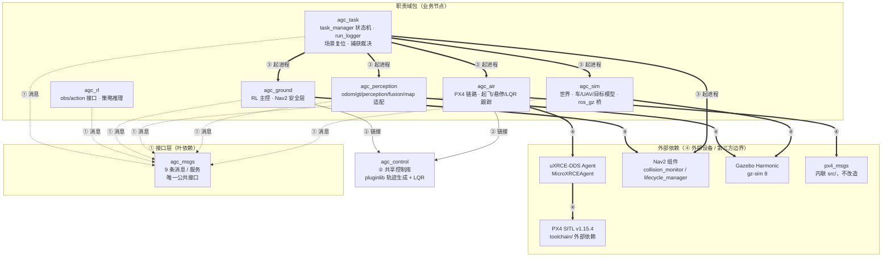
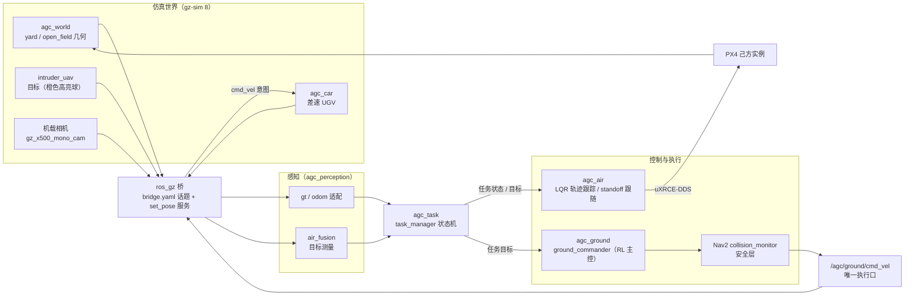

# 系统结构图

> 本文件是 [包边界](包边界.md) 的**图形式表达**，内容必须与之一致；包边界是真源，图是它的投影。
> 依赖方向按**四类**分别表示（消息 / 库链接 / 运行组合 / 外部设备），**不混为一条线**——
> 混为一条正是 [ADR-0059](../adr/0059-package-dependency-taxonomy-and-boundary-revision.md) 要纠正的误读。
>
> 生成方式：Mermaid（可版本控制、可 diff、GitHub 原生渲染）。PNG/SVG 由本仓脚本渲染，**不手绘**
> （手绘必然与真源漂移，且无法在 diff 里看出漂移）。

## 1. 8 包与四类依赖

**读图要点**（三条最容易读错的地方）：

1. **`agc_task → 其它域包`是③不是②**：它只在 launch 里**起进程**，`exec_depend` 声明，
   **不链接**任何域实现库。运行组合与库链接是两码事。
2. **`agc_control` 是唯一的②例外**：只有它允许被 `agc_air` / `agc_ground` 链接**同一实现**；
   其余业务库**禁止互链**。
3. **`px4_msgs` 不是第 9 个包**：它是内联入库的第三方包（pin `a1045ec` / `release/1.15`），
   原样置于 `src/`、**不改造**，只有 `agc_air` 用它。

## 2. 数据流（一次演示里的实际流向）

**红线标注**（图里画不出、但必须知道）：

- **唯一执行口**：地面速度命令**只**经 `/agc/ground/cmd_vel` 下发（[契约#execution-port](../../docs/ROS2迁移交接文档.md#execution-port)）；
  `run_demo.sh` 与任何展示层**不得**直接写它，也不得写模型位姿。
- **终态表述**：`TRACKING_SUCCESS` = "抵近并持续跟踪"，**不是**"拦截完成"
  （[契约#terminal-semantics](../../docs/ROS2迁移交接文档.md#terminal-semantics)）。
- **感知两路径互斥**：`/agc/perception/path` ∈ {`truth`, `vision`}，同一 run 不得混跑
  （[契约#perception-path](../../docs/ROS2迁移交接文档.md#perception-path)）。

## 3. 包清单对照

与 [包边界 §1](包边界.md#1-包清单) **逐行一致**；此处只给速查，职责细节以包边界为准。

| 包 | 职责域 | 构建 | 一句话 |
|---|---|---|---|
| `agc_msgs` | 接口与消息 | `ament_cmake` + rosidl | 9 条消息 / 服务，唯一公共接口（叶依赖） |
| `agc_sim` | 仿真世界与模型 | `ament_cmake` | 世界、车 / UAV / 目标模型、`ros_gz` 桥、传感器链路 |
| `agc_control` | 通用控制层（共享库） | `ament_cmake` | pluginlib 轨迹生成器 / LQR 控制器插件，air / ground 共用 |
| `agc_air` | 空中链路 | `ament_cmake` | PX4 uXRCE-DDS、起飞 / 悬停 / LQR 跟踪、跟随 |
| `agc_perception` | 感知与融合 | `ament_cmake` | odom / gt / perception / fusion / map 适配节点 |
| `agc_ground` | 地面导航与安全层 | `ament_cmake` | RL 主控链路、Nav2 `collision_monitor`、离线基线 |
| `agc_task` | 任务与评估 | `ament_cmake` | `task_manager`、`run_logger`、场景、评估、捕获裁决 |
| `agc_rl` | RL 平台 | `ament_python` | RL 接口（obs / action）+ 策略加载与推理节点 |
| `px4_msgs` | 第三方（内联） | `ament_cmake` | PX4 消息定义，原样入库、不改造 |

## 4. 一致性怎么保证

不是靠纪律，靠**可执行检查**：

- `colcon list` 的包名集合须与上表一致（8 包 + `px4_msgs`）；
- 依赖方向由 [`scripts/dep_audit.py`](../../scripts/dep_audit.py) 审计；
- 本文件与包边界的**表格漂移**由文档断链检查（`tests/docs_link_check.py`）与冒烟门槛
  （`./run_demo.sh test`）覆盖；
- 图与真源冲突时**以包边界为准**，并立即改图——不允许图单独演进。
